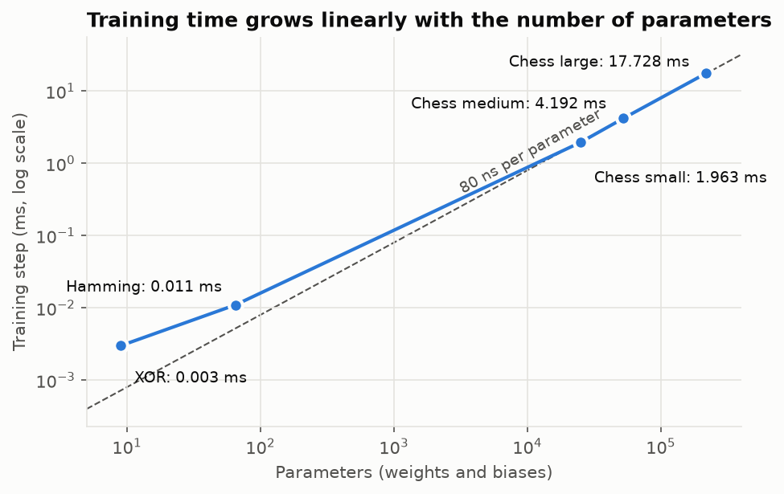
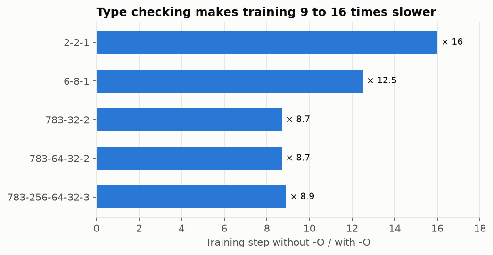
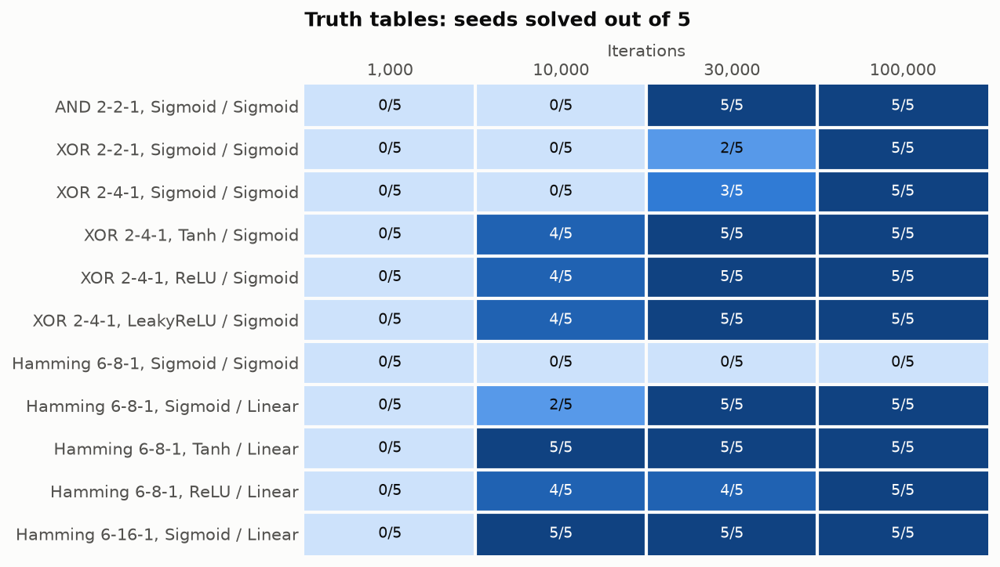
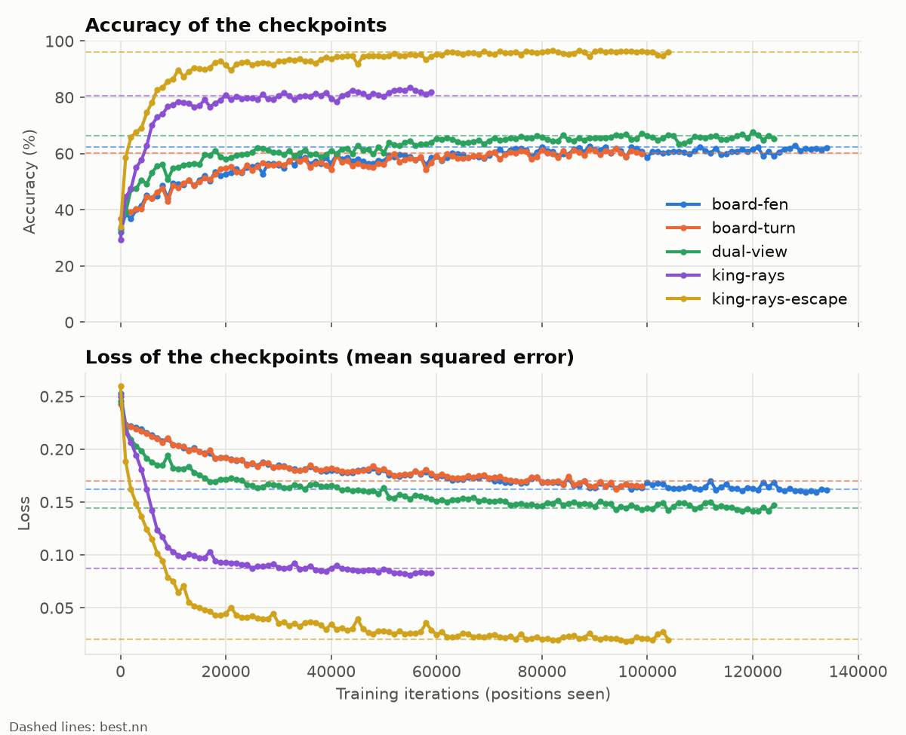

# Benchmarks

This document measures how fast MyTorch is, how well it learns the truth tables of `my_torch_bonus`, and what it achieves on chess positions with each input encoding. Most numbers can be reproduced with the scripts of [`benchmarks/`](../benchmarks/); the exceptions are marked.

- [Setup](#setup)
- [Speed](#speed)
- [Cost of type checking](#cost-of-type-checking)
- [Truth tables](#truth-tables)
- [Chess positions](#chess-positions)
  - [Input formats](#input-formats)
- [Training curves](#training-curves)
- [Summary](#summary)

## Setup

| Item       | Value                                         |
|------------|-----------------------------------------------|
| CPU        | Intel Core Ultra 7 255H (one core used)       |
| Python     | 3.14.3                                        |
| typeguard  | 4.6.0                                         |
| Code       | commit `adc7c32`; commit `d8806ee` for the 141-input measures |
| Date       | 2026-10-28                                    |

Unless stated otherwise, benchmarks run with `python -O`, which disables the `typeguard` checks (see [below](#cost-of-type-checking)).

| Script                          | What it does                                                                                       | Section |
|---------------------------------|----------------------------------------------------------------------------------------------------|---------|
| `benchmarks/speed.py`           | Times one forward pass and one training step for several network shapes (a few seconds).           | [Speed](#speed) |
| `benchmarks/tables.py [N]`      | Trains every truth-table configuration with 5 seeds for `N` iterations (default 100,000, about 1 minute). | [Truth tables](#truth-tables) |
| `benchmarks/chess_dataset.py`   | Trains a 783-32-2 network on a sample of the dataset. Written for the former 783-input encoding: it no longer runs with the current one (141 inputs). | [Learning](#learning) |
| `benchmarks/checkpoints_csv.py` | Evaluates every checkpoint saved by `my_torch_analyzer --train` and writes a CSV.                   | [Training curves](#training-curves) |
| `benchmarks/checkpoints_plot.py`| Draws the accuracy and loss curves of one or several CSV files made by `checkpoints_csv.py`.        | [Input formats](#input-formats), [Training curves](#training-curves) |
| `benchmarks/plots.py`           | Draws the charts of this document from the numbers of its tables.                                  | — |

```sh
.venv/bin/python -O benchmarks/speed.py
.venv/bin/python -O benchmarks/tables.py
```

The charts of the [Speed](#speed), [Cost of type checking](#cost-of-type-checking) and [Truth tables](#truth-tables) sections are drawn by `benchmarks/plots.py` from the numbers of its tables, and saved in [`docs/images/`](images/) (`speed.png`, `typeguard.png`, `convergence.png`; `input_formats_comparaison.png` comes from `checkpoints_plot.py`). It needs `matplotlib`; after changing a table, update the numbers at the top of the script and run it again:

```sh
.venv/bin/python benchmarks/plots.py
```

## Speed

Time of one forward pass (`tick`) and of one training step (`tick` then `learn`), for the networks of the truth tables and for chess-sized networks:

| Network      | Shape            | Parameters | Forward (ms) | Training step (ms) | Steps / s |
|--------------|------------------|-----------:|-------------:|-------------------:|----------:|
| XOR          | 2-2-1            | 9          | 0.001        | 0.003              | 290,535   |
| Hamming      | 6-8-1            | 65         | 0.003        | 0.011              | 88,975    |
| Chess small  | 783-32-2         | 25,154     | 0.814        | 1.963              | 509       |
| Chess medium | 783-64-32-2      | 52,322     | 1.709        | 4.192              | 239       |
| Chess large  | 783-256-64-32-3  | 219,331    | 7.120        | 17.728             | 56        |

The time grows linearly with the number of parameters (about 80 ns per parameter per training step for the chess networks), as expected from loops that visit every weight once forward and once backward.



The two truth table networks sit above the 80 ns line: with so few weights, the fixed cost of the Python calls (one per neuron) dominates.

What this means for one pass over the 723,019 positions of the chess dataset:

| Network      | With `-O`  | Without `-O` |
|--------------|-----------:|-------------:|
| 783-32-2     | ≈ 24 min   | ≈ 3 h 05     |
| 783-64-32-2  | ≈ 50 min   | ≈ 6 h 30     |
| 783-256-64-32-3 | ≈ 3 h 35 | ≈ 28 h       |

### With the current encoding (141 inputs, 5 outputs)

The chess networks above use the former 783-input encoding. With the King-Rays-Escape encoding, the first layer is 5.5 times smaller. Same measure (`tick` then `learn`, `batchSize` 1, LeakyReLU / Sigmoid), on 1,000 encoded positions of the dataset. These shapes are not in `speed.py`, so they were measured separately:

| Shape         | Parameters | Training step, `-O` (ms) | Training step, checks on (ms) | Slowdown | One pass over the dataset, `-O` |
|---------------|-----------:|-------------------------:|------------------------------:|---------:|--------------------------------:|
| 141-64-5      | 9,413      | 0.90                     | 12.6                          | × 14.0   | ≈ 11 min                        |
| 141-64-32-5   | 11,333     | 1.17                     | 15.1                          | × 13.0   | ≈ 14 min                        |
| 141-128-64-5  | 26,757     | 2.85                     | 35.4                          | × 12.4   | ≈ 34 min                        |

That is about 100 ns per parameter, a little more than with 783 inputs: the network is smaller, so the fixed cost of the Python call of each neuron weighs more. Parsing and encoding take about 0.13 ms and 1.6 KB of memory per position (17 KB with the former encoding), so the whole dataset fits in about 1.2 GB.

A training of the analyzer runs 20 epochs, with the rare labels oversampled (see [CHESS_ANALYZER.md](CHESS_ANALYZER.md#how-a-training-goes)): on a file made by `./dataset.sh 2000` (18,000 positions), that is about 580,000 training steps, around 12 minutes for a 141-64-32-5 network with `-O`.

## Cost of type checking

Same measure, with and without the runtime checks of `typeguard`:

| Network          | Training step, checks on (ms) | Training step, `-O` (ms) | Slowdown |
|------------------|------------------------------:|-------------------------:|---------:|
| 2-2-1            | 0.048                         | 0.003                    | × 16     |
| 6-8-1            | 0.138                         | 0.011                    | × 12.5   |
| 783-32-2         | 15.40                         | 1.77                     | × 8.7    |
| 783-64-32-2      | 32.45                         | 3.75                     | × 8.7    |
| 783-256-64-32-3  | 138.3                         | 15.5                     | × 8.9    |



`typeguard` checks every argument of every call, including every element of the input lists, and the network makes one call per neuron per sample. The checks catch type errors early during development (see [DESIGN_CHOICES.md](DESIGN_CHOICES.md#runtime-type-checking-with-typeguard)), but for long trainings `-O` should always be used:

```sh
.venv/bin/python -O my_torch_analyzer --train chess_1.nn train.txt
.venv/bin/python -O my_torch_bonus --train hamming hamming_1.nn
```

## Truth tables

Each configuration is trained 5 times, with seeds 1 to 5, on random rows of the table. A seed is **solved** when every row of the table is within the tolerance of the task (`0.1` for AND and XOR, `0.5` for Hamming, see the [README](../README.md#truth-table-trainer)). The mean accuracy is the share of rows within the tolerance, averaged over the 5 seeds.

### After 100,000 iterations (the default of `my_torch_bonus --train`)

| Task    | Shape  | Learning rate | Hidden / output     | Mean accuracy | Seeds solved | Time (s) |
|---------|--------|--------------:|---------------------|--------------:|-------------:|---------:|
| AND     | 2-2-1  | 0.1           | Sigmoid / Sigmoid   | 100.0 %       | 5/5          | 0.3      |
| XOR     | 2-2-1  | 0.1           | Sigmoid / Sigmoid   | 100.0 %       | 5/5          | 0.3      |
| XOR     | 2-4-1  | 0.1           | Sigmoid / Sigmoid   | 100.0 %       | 5/5          | 0.5      |
| XOR     | 2-4-1  | 0.1           | Tanh / Sigmoid      | 100.0 %       | 5/5          | 0.5      |
| XOR     | 2-4-1  | 0.1           | ReLU / Sigmoid      | 100.0 %       | 5/5          | 0.5      |
| XOR     | 2-4-1  | 0.1           | LeakyReLU / Sigmoid | 100.0 %       | 5/5          | 0.5      |
| Hamming | 6-8-1  | 0.05          | Sigmoid / Sigmoid   | 37.5 %        | 0/5          | 1.1      |
| Hamming | 6-8-1  | 0.05          | Sigmoid / Linear    | 100.0 %       | 5/5          | 1.1      |
| Hamming | 6-8-1  | 0.05          | Tanh / Linear       | 100.0 %       | 5/5          | 1.1      |
| Hamming | 6-8-1  | 0.01          | ReLU / Linear       | 100.0 %       | 5/5          | 1.1      |
| Hamming | 6-16-1 | 0.05          | Sigmoid / Linear    | 100.0 %       | 5/5          | 2.0      |

### Convergence: seeds solved after N iterations

| Task    | Shape  | Hidden / output     | 1,000 | 10,000 | 30,000 | 100,000 |
|---------|--------|---------------------|------:|-------:|-------:|--------:|
| AND     | 2-2-1  | Sigmoid / Sigmoid   | 0/5   | 0/5    | 5/5    | 5/5     |
| XOR     | 2-2-1  | Sigmoid / Sigmoid   | 0/5   | 0/5    | 2/5    | 5/5     |
| XOR     | 2-4-1  | Sigmoid / Sigmoid   | 0/5   | 0/5    | 3/5    | 5/5     |
| XOR     | 2-4-1  | Tanh / Sigmoid      | 0/5   | 4/5    | 5/5    | 5/5     |
| XOR     | 2-4-1  | ReLU / Sigmoid      | 0/5   | 4/5    | 5/5    | 5/5     |
| XOR     | 2-4-1  | LeakyReLU / Sigmoid | 0/5   | 4/5    | 5/5    | 5/5     |
| Hamming | 6-8-1  | Sigmoid / Sigmoid   | 0/5   | 0/5    | 0/5    | 0/5     |
| Hamming | 6-8-1  | Sigmoid / Linear    | 0/5   | 2/5    | 5/5    | 5/5     |
| Hamming | 6-8-1  | Tanh / Linear       | 0/5   | 5/5    | 5/5    | 5/5     |
| Hamming | 6-8-1  | ReLU / Linear       | 0/5   | 4/5    | 4/5    | 5/5     |
| Hamming | 6-16-1 | Sigmoid / Linear    | 0/5   | 5/5    | 5/5    | 5/5     |

Reproduce a column with `.venv/bin/python -O benchmarks/tables.py N`.



### What we learn

- **The backpropagation is correct.** XOR is not linearly separable, so it can only be solved if the error reaches the hidden layer correctly. Every tested configuration solves it.
- **The output activation decides what can be learnt.** With a `Sigmoid` output, the Hamming network is stuck at 37.5 %: its output stays below 1, so distances 2 and 3 are always wrong, and the network settles on an output close to 1, right only on the 24 rows out of 64 at distance 1. A `Linear` output solves it with the same hidden layer. This is why configuration files can choose the output activation separately.
- **The hidden activation decides how fast it is learnt.** `Tanh`, `ReLU` and `LeakyReLU` hidden layers solve XOR about 3 times sooner than `Sigmoid` (most seeds at 10,000 iterations instead of 30,000 to 100,000). `Sigmoid`'s derivative is at most `0.25`, which shrinks the error sent back to the hidden layer; `Tanh`'s goes up to `1`.
- **More hidden neurons also help.** With 16 hidden neurons instead of 8, the Hamming network is solved by every seed after 10,000 iterations.
- **The default of 100,000 iterations is enough** for every configuration that can solve its task, in about one second with `-O`.

## Chess positions

### Parsing

`fen_parser` checks every line with `python-chess` before encoding it. Measured with the former 783-input encoding:

| Measure                          | Value                     |
|----------------------------------|---------------------------|
| Parsing speed                    | ≈ 19,600 positions / s    |
| Full dataset (723,019 positions) | ≈ 37 s                    |
| Memory per encoded position      | ≈ 17 KB                   |
| Full dataset in memory           | ≈ 12 GB                   |

Parsing is negligible next to training (37 s against 24 min for one pass of the smallest network), but memory is not: large training files should be split into chunks (see [CHESS_ANALYZER.md](CHESS_ANALYZER.md#training-on-the-dataset)).

### Learning

> These measures were made at commit `adc7c32`, with the former encoding (783 inputs: 64 squares × 12 piece planes plus the other FEN fields) and 2 outputs. The analyzer now uses the King-Rays-Escape encoding (141 inputs) and 5 outputs: [Input formats](#input-formats) below compares the five encodings that were tried. The results below are kept because they show why the encoding had to change.

Networks are trained on a balanced sample of the dataset: 1,000 random positions from each of the 9 files, so one third `Nothing` and two thirds `Check` or `Checkmate`. 7,200 positions are used for training, 1,800 for testing. Since 65.8 % of the test positions are `Check`, a network that always answers `Check` already scores **65.8 %**: this is the baseline to beat.

**Activation functions and depth**, 3 epochs, learning rate 0.01:

| Shape         | Hidden / output   | Test accuracy | Training time (s) |
|---------------|-------------------|--------------:|------------------:|
| 783-32-2      | Sigmoid / Sigmoid | 64.6 %        | 44                |
| 783-32-2      | Tanh / Sigmoid    | 64.9 %        | 42                |
| 783-32-2      | ReLU / Sigmoid    | 64.6 %        | 43                |
| 783-64-32-2   | Sigmoid / Sigmoid | 65.9 %        | 90                |

**Learning rate and piece colours**, 783-32-2, Sigmoid / Sigmoid, test accuracy after N epochs (share of test positions predicted `Check` in brackets):

| Piece colours in the input | Learning rate | 1 epoch        | 5 epochs       | 10 epochs      |
|----------------------------|--------------:|---------------:|---------------:|---------------:|
| Not distinguished (`adc7c32`) | 0.01       | 63.4 % (94 %)  | 65.4 % (96 %)  | 66.2 % (96 %)  |
| Distinguished              | 0.002         | 63.2 % (93 %)  | 64.3 % (95 %)  | 64.6 % (95 %)  |
| Distinguished              | 0.01          | 63.5 % (90 %)  | 65.7 % (94 %)  | 66.3 % (95 %)  |
| Distinguished              | 0.05          | 65.6 % (94 %)  | 67.3 % (86 %)  | **68.8 %** (79 %) |

At commit `adc7c32`, `Color.getColor` returns `BLACK` for every piece, so white and black pieces use the same 6 of the 12 values of each square. The "distinguished" rows replace it with the intended function (`WHITE` for upper-case letters) to measure the effect of the fix.

The last row was measured with `.venv/bin/python -O benchmarks/chess_dataset.py 10 0.05`. The script builds a 783-input network, so it no longer runs with the current encoding.

What we learn:

- **On 7,200 positions, the networks barely beat the baseline.** Most answer `Check` for almost every position. Training accuracy stays close to test accuracy, so the problem is not over-fitting: the networks have not found how to detect a check yet.
- **Detecting a check is hard for a small network.** A check depends on the relation between two squares that can be far apart (a rook or a bishop on the other side of the board, with nothing in between). With one-hot squares, each such pattern has to be learnt separately for every pair of squares, which needs far more than 7,200 examples.
- **Distinguishing the colours and a larger learning rate help.** With both, accuracy keeps going up after 10 epochs (68.8 %) and the network starts answering `Nothing`, which none of the other configurations does.
- **The encoding was the main problem.** Since the network has to discover by itself that a check is a relation between distant squares, the input was redesigned around the king of the side to move: the King-Rays-Escape encoding gives it the pieces seen along each ray from the king and the attacked squares around it, in 141 inputs (see [Input formats](#input-formats)).

### Input formats

After the results above, five input encodings were compared under the same conditions (details of each encoding in [INPUT_FORMATS_COMPARAISON.md](INPUT_FORMATS_COMPARAISON.md)):

- the same training file, the same validation split and the same order of the positions;
- the same network for every encoding, only `nbInputs` changes: `N-64-32-3`, LeakyReLU / Sigmoid, learning rate 0.01, momentum 0.5, initial bias 0, `seed: 42`, `patience: 5`, `validationInterval: 5000`;
- 3 outputs: `Nothing`, `Check`, `Checkmate` (the analyzer has 5 since, one per label);
- every checkpoint evaluated on the same positions with `checkpoints_csv.py`, the five CSV files drawn together with `checkpoints_plot.py`.



Values of `best.nn` (dashed lines), read from the chart:

| Encoding             | `nbInputs` | Accuracy of `best.nn` | Loss of `best.nn` | Positions seen before the end of training |
|----------------------|-----------:|----------------------:|------------------:|------------------------------------------:|
| Board-FEN            | 783        | ≈ 62 %                | ≈ 0.16            | ≈ 135,000                                 |
| Board-Turn           | 769        | ≈ 60 %                | ≈ 0.17            | ≈ 100,000                                 |
| Dual-View            | 1551       | ≈ 66 %                | ≈ 0.145           | ≈ 125,000                                 |
| King-Rays            | 133        | ≈ 80 %                | ≈ 0.09            | ≈ 60,000                                  |
| **King-Rays-Escape** | **141**    | **≈ 96 %**            | **≈ 0.02**        | ≈ 105,000                                 |

What we learn:

- **The three raw-board encodings stay around 60 to 66 %**, like the 783-input results above. Removing the extra FEN fields (Board-Turn) changes nothing; describing the board from each player (Dual-View) gains a few points with twice the inputs.
- **Describing the board from the king is what makes the difference.** King-Rays reaches 80 % with 6 times fewer inputs than Board-FEN, and adding whether the squares around the king are attacked (King-Rays-Escape) brings it to 96 %: these squares are what separates a check from a checkmate.
- **King-Rays-Escape also learns fastest**: it is above 90 % after about 15,000 positions, an accuracy the raw-board encodings never reach.
- **Smaller inputs train faster**: a step of a 141-input network takes about a third of the time of a 783-input one (see [Speed](#with-the-current-encoding-141-inputs-5-outputs)).

This is why the analyzer uses King-Rays-Escape. To reproduce a curve, train one network per encoding with a different `--save` (the curves are labelled with the name of the checkpoint directory), then:

```sh
.venv/bin/python -O benchmarks/checkpoints_csv.py king-rays-escape test.txt
.venv/bin/python benchmarks/checkpoints_plot.py board-fen/checkpoints.csv board-turn/checkpoints.csv dual-view/checkpoints.csv king-rays/checkpoints.csv king-rays-escape/checkpoints.csv -o docs/images/input_formats_comparaison.png
```

Only King-Rays-Escape is in the code now: the four other encodings would have to be written again in `chessboard.py` to train them.

## Training curves

The tables above give one number per configuration. To see how a network improves during a training, the analyzer saves a checkpoint every 1,000 positions, and two scripts turn them into a chart.

```sh
.venv/bin/python -O my_torch_analyzer --train --save chess_trained.nn chess_1.nn train.txt
.venv/bin/python -O benchmarks/checkpoints_csv.py chess_trained test.txt
.venv/bin/python benchmarks/checkpoints_plot.py chess_trained/checkpoints.csv -o training.png
```

**Checkpoints.** `my_torch_analyzer --train --save SAVEFILE` saves `model_N.nn` every 1,000 positions (`CHECKPOINT_EVERY` in [train.py](../src/my_torch_analyzer/train.py)) in the directory named after `SAVEFILE` without `.nn` (`chess_trained/` above). If the configuration sets `patience`, the best network on the validation set is also saved there as `best.nn`.

**`checkpoints_csv.py DIRECTORY [CHESSFILE] [PER_FILE]`** evaluates every `model_N.nn` of `DIRECTORY` on the same positions and writes `DIRECTORY/checkpoints.csv`:

- `CHESSFILE`: labelled positions to evaluate on, for example a `test.txt` the network was not trained on. Without it, `PER_FILE` positions (default 100) are picked from each of the 9 files of `dataset/` with a fixed seed, so 900 positions.
- Columns: `iteration,accuracy,loss`, with the accuracy in % and the loss as the mean squared error, the loss minimised by `MLP.learn`. If `best.nn` exists, it is added as a last row with the iteration `best`.
- `checkpoints.csv` is not a `.nn` file: a new `--train` with the same `SAVEFILE` refuses to overwrite the directory until it is deleted.

**`checkpoints_plot.py CSV [CSV ...] [-o OUTPUT]`** draws the accuracy and the loss against the number of positions seen, one curve per CSV file, and saves the chart in `OUTPUT` (default `checkpoints_comparison.png`):

- Each curve is labelled with the name of the directory of its CSV file (or the file name if two directories have the same name), so name the `SAVEFILE` of each training after what it tests.
- The `best` row is drawn as a dashed horizontal line of the same colour.
- One CSV shows how a network improves; several CSV files compare trainings, as in [Input formats](#input-formats).

To draw the training curves of the best configuration found by `my_torch_hyperoptimizer`, follow [Finding the best model](../README.md#finding-the-best-model) in the README.

## Summary

| Question                                         | Answer                                                              |
|--------------------------------------------------|---------------------------------------------------------------------|
| Does the backpropagation work?                   | Yes: AND, XOR and Hamming are learnt perfectly by every seed.       |
| Which activation functions to use?               | `Tanh` or `ReLU` in hidden layers; an output that can reach the expected values (`Linear` for counts). |
| How long does a training take?                   | About 80 to 100 ns per parameter per sample with `-O`: 14 min per pass of the dataset for the 141-64-32-5 network, about 12 min for a full training on `./dataset.sh 2000`. |
| Should training use `-O`?                        | Yes: type checking makes it 9 to 16 times slower.                   |
| Does the chess analyzer work?                    | With the former 783-input encoding, it barely beat always answering `Check` on 7,200 positions (68.8 % against 65.8 %), which led to compare other encodings. |
| Which input encoding to use?                     | King-Rays-Escape (141 inputs): ≈ 96 % against 60 to 66 % for the raw-board encodings, with the same network (see [Input formats](#input-formats)). |
| How to see a network improve?                    | `checkpoints_csv.py` then `checkpoints_plot.py` on the checkpoints of `my_torch_analyzer --train` (see [Training curves](#training-curves)). |
