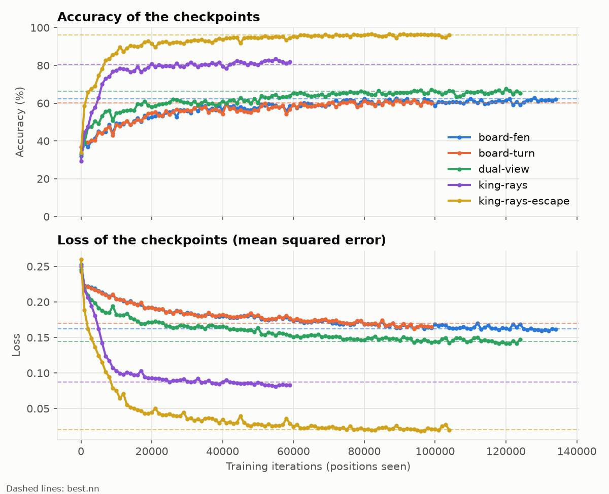

# Input Format Comparison - Chessboard Analyzer

## Table of contents

1. [Context](#1-context)
2. [Experimental protocol](#2-experimental-protocol)
3. [Overview of the five formats](#3-overview-of-the-five-formats)
4. [Format descriptions](#4-format-descriptions)
   1. [Board-FEN (783 inputs)](#41-board-fen---783-inputs)
   2. [Board-Turn (769 inputs)](#42-board-turn---769-inputs)
   3. [Dual-View (1551 inputs)](#43-dual-view---1551-inputs)
   4. [King-Rays (133 inputs)](#44-king-rays---133-inputs)
   5. [King-Rays-Escape (141 inputs)](#45-king-rays-escape---141-inputs-implemented-format)
5. [Training curves](#5-training-curves)
6. [Conclusion](#6-conclusion)
7. [References](#7-references)

---

## 1. Context

The analyzer receives a chessboard written in Forsyth–Edwards Notation (FEN) and must answer `Nothing`, `Check` or `Checkmate`. A FEN record is a line of text made of six fields: piece placement, active colour, castling availability, en passant target square, halfmove clock and fullmove number.

A neural network only accepts numbers, so the first design decision is the **input format**: which numbers describe a position. This choice fixes `nbInputs` (the width of the first layer) and determines how much of the problem the network has to discover by itself. Five formats were designed and tested, from a literal translation of the FEN string to a representation built around the king.

## 2. Experimental protocol

All five formats were trained under identical conditions:

- the same dataset, the same train/validation split and the same sample order;
- the same network configuration (below), where only `nbInputs` changes;
- the same seed (`seed: 42`), so weight initialisation is reproducible;
- the same metrics recorded throughout training: **accuracy** and **loss**.

Network configuration used for every format:

```yaml
nbInputs: <see the table in section 3>
nbOutputs: 3
hiderLayersLayout:
  - 64
  - 32
learningRate: 0.01
hiddenActivationFunction: LeakyReLU
outputActivationFunction: Sigmoid
momentum: 0.5
initialBias: 0.0
seed: 42
patience: 5
validationInterval: 5000
```

The three outputs are `Nothing`, `Check` and `Checkmate`. The colour of the side giving the check is not part of this comparison. Since then, the analyzer has 5 outputs, one per label (`Check White`, `Check Black`...): see [CHESS_ANALYZER.md](CHESS_ANALYZER.md#output-encoding).

## 3. Overview of the five formats

| # | Name | `nbInputs` | In one line |
|---|------|-----------:|-------------|
| 1 | **Board-FEN** | 783 | 64 squares × 12 piece planes, plus every other FEN field |
| 2 | **Board-Turn** | 769 | 64 squares × 12 piece planes, plus the colour to play |
| 3 | **Dual-View** | 1551 | NNUE-inspired: one board view per player, side to move first |
| 4 | **King-Rays** | 133 | The board seen from the king of the side to move |
| 5 | **King-Rays-Escape** | 141 | King-Rays plus "is this neighbouring square attacked?" flags |

---

## 4. Format descriptions

### 4.1 Board-FEN - 783 inputs

Each of the 64 squares is described by 12 binary inputs, one for every combination of piece type (king, queen, rook, bishop, knight, pawn) and colour, so an empty square is all zeros and an occupied square contains a single 1. The squares are read in FEN order, from a8 to h1, which gives 64 × 12 = 768 piece-square inputs. Fifteen further inputs carry the remaining FEN fields: the active colour (1), the four castling rights (4), the en passant file (8), and the halfmove and fullmove counters scaled to the range [0, 1] (2). It is the most literal translation of a FEN record into numbers and makes no assumption about chess, which makes it the natural baseline of this study. Its limitation is that "the king is attacked" is a relation between distant squares that the encoding never states, so the network has to discover it from the raw placement.

References: [A simple input feature set - Stockfish NNUE documentation](https://official-stockfish.github.io/docs/nnue-pytorch-wiki/docs/nnue.html#a-simple-input-feature-set) · [Forsyth–Edwards Notation - Chess Programming Wiki](https://chessprogramming.org/Forsyth-Edwards_Notation)

### 4.2 Board-Turn - 769 inputs

This format keeps the same 768 piece-square inputs as Board-FEN and adds a single input, the colour to play (1 for white, 0 for black). Castling rights, the en passant target and the move counters are removed because none of them is needed to know whether the king of the side to move is attacked. The colour to play is kept because, in a legal position, only the side to move can be in check, so it tells the network whose king matters. Removing the extra fields shortens the input and avoids offering the network features that could act as accidental shortcuts, such as the move number, which depends on how the dataset was generated. Comparing it with Board-FEN isolates the effect of those extra FEN fields, because the board part is identical.

References: [Forsyth–Edwards Notation - Chess Programming Wiki](https://chessprogramming.org/Forsyth-Edwards_Notation) · [A simple input feature set - Stockfish NNUE documentation](https://official-stockfish.github.io/docs/nnue-pytorch-wiki/docs/nnue.html#a-simple-input-feature-set)

### 4.3 Dual-View - 1551 inputs

This format adapts the idea of NNUE, where a position is described from the point of view of both players instead of in absolute colours. Each view has 768 inputs ("own" or "enemy" piece × 6 types × 64 squares); for black's view the board is flipped vertically and the colours are reversed, so a player's own pieces always start at the bottom of the board. The two views are concatenated with the side to move first, an ordering that the NNUE documentation presents as a way to let the network learn whose turn it is and to make its output relative to the side to move. Fifteen extra inputs follow (colour to play, castling rights relative to the side to move, en passant file and the two counters), for a total of 2 × 768 + 15 = 1551. Unlike Stockfish's NNUE, which relies on HalfKP features (40,960 per perspective), sparse accumulators and incremental updates, this version is a small dense adaptation in which each of the two input blocks has its own weights, an option the documentation describes as valid.

References: [Multiple perspectives, multiple accumulators - Stockfish NNUE documentation](https://official-stockfish.github.io/docs/nnue-pytorch-wiki/docs/nnue.html#multiple-perspectives-multiple-accumulators) · [HalfKP - Stockfish NNUE documentation](https://official-stockfish.github.io/docs/nnue-pytorch-wiki/docs/nnue.html#halfkp)

### 4.4 King-Rays - 133 inputs

Check is a property of the king of the side to move, so this format describes the board from that king instead of describing all 64 squares. From the king, eight rays (N, NE, E, SE, S, SW, W, NW) are scanned and, for each one, the first piece met is recorded as one of 12 kinds (own or enemy × 6 types) together with its distance, which gives 8 × 13 = 104 inputs. Eight inputs mark the squares a knight would attack from and two inputs mark the squares from which an enemy pawn would attack; each of the 8 neighbouring squares gets two flags (off the board, own piece on it), and the king's row, column and the colour to play complete the vector: 104 + 8 + 2 + 16 + 3 = 133. Pieces are labelled "own" and "enemy" rather than white and black, so the same pattern applies to both colours, and describing pieces relative to the king follows the idea of the HalfRelativeKP features of the NNUE documentation. The format states where the possible attackers are, but not which squares around the king the enemy controls.

References: [HalfRelativeKP factors - Stockfish NNUE documentation](https://official-stockfish.github.io/docs/nnue-pytorch-wiki/docs/nnue.html#halfrelativekp-factors) · [Checks and Pinned Pieces - Chess Programming Wiki](https://chessprogramming.org/Checks_and_Pinned_Pieces_(Bitboards))

### 4.5 King-Rays-Escape - 141 inputs (implemented format)

This format is King-Rays plus eight additional inputs, one per square around the king, indicating whether the enemy attacks that square. The attack test looks outward from the square (along the eight rays, then knight jumps and pawn squares), a standard technique in chess programs, and it is applied with the king temporarily removed from the board. Removing the king matters because a checking rook or queen also attacks the square behind the king along the line of the check, which would otherwise look like a safe retreat. Together, the rays tell whether the king is attacked and the neighbour flags describe which surrounding squares are free, blocked by an own piece, off the board or attacked, which are most of the facts needed to tell a check from a checkmate. The input never contains an "in check" or "checkmate" answer, so the network still has to learn how these facts combine, including whether a checking piece can be captured or blocked.

References: [Square Attacked By - Chess Programming Wiki](https://chessprogramming.org/Square_Attacked_By) · [Checks and Pinned Pieces - Chess Programming Wiki](https://chessprogramming.org/Checks_and_Pinned_Pieces_(Bitboards)) · [HalfKP - Stockfish NNUE documentation](https://official-stockfish.github.io/docs/nnue-pytorch-wiki/docs/nnue.html#halfkp)

#### Layout of the 141 inputs

| Group | Inputs | Content |
|-------|-------:|---------|
| Rays | 104 | 8 directions × (12 piece kinds, own/enemy × 6 types, + 1 distance) |
| Knight squares | 8 | An enemy knight is on the square |
| Pawn squares | 2 | An enemy pawn is on a square that attacks the king |
| Neighbouring squares | 16 | 8 squares × (off the board, own piece on it) |
| Escape squares | 8 | 8 neighbouring squares × (attacked by the enemy, king removed) |
| King | 3 | King row, king column, colour to play |
| **Total** | **141** | All values are in [0, 1] |

All values are relative to the side to move: a piece is *own* or *enemy*, never white or black. The board is read on the FEN grid, where row 0 is rank 8. The pawn squares depend on the colour to play, because white and black pawns attack in opposite directions.

#### How the "attacked" test works

The test starts from the target square and looks outward:

1. **Rays**: along each of the 8 directions it stops at the first piece. If that piece is an enemy that can capture along the ray (queen in any direction, rook in straight lines, bishop on diagonals, king only when adjacent), the square is attacked.
2. **Knights**: an enemy knight on one of the 8 knight-jump squares attacks the square.
3. **Pawns**: an enemy pawn on one of the 2 squares from which it captures towards the target attacks the square.

The same function answers "is the king in check?" when it is called from the king's square, and "can the king step here?" when it is called from a neighbouring square on a board without the king.

#### Known limits

The format does not describe pins, whether a checking piece can be captured or blocked by another piece, en passant captures, or castling. These facts are either rare or left to the network to infer from the rays and neighbour flags.

---

## 5. Training curves

The figure below shows the accuracy and the loss during training for the five formats, with the same dataset and hyperparameters. The values reached by each format are in [BENCHMARKS.md](BENCHMARKS.md#input-formats).



## 6. Conclusion

With the same dataset and the same hyperparameters, **King-Rays-Escape (141 inputs)** was the best of the five formats: it identified the state of the board (`Nothing`, `Check` or `Checkmate`) more accurately and reached that level in fewer training steps than the other four.

The reason is the way the information is presented. The raw-board formats (Board-FEN, Board-Turn and Dual-View) describe where every piece stands and leave the network to work out which of them threaten a king. King-Rays-Escape describes the position from the king of the side to move, so the facts that define the state (which pieces attack the king, and which neighbouring squares are free, blocked or attacked) appear in the same place of the input whatever the position on the board. This is also the format implemented in `chessboard.py`.

This study varies only the input format. The hyperparameters (layer sizes, learning rate, activation functions, …) are searched by `my_torch_hyperoptimizer` on top of this encoding: see [Finding the best model](../README.md#finding-the-best-model).


## 7. References

- Stockfish documentation, *NNUE* (feature sets, perspectives, HalfKP, HalfRelativeKP): <https://official-stockfish.github.io/docs/nnue-pytorch-wiki/docs/nnue.html>
- Chess Programming Wiki, *Forsyth–Edwards Notation*: <https://chessprogramming.org/Forsyth-Edwards_Notation>
- Chess Programming Wiki, *Square Attacked By*: <https://chessprogramming.org/Square_Attacked_By>
- Chess Programming Wiki, *Checks and Pinned Pieces (Bitboards)*: <https://chessprogramming.org/Checks_and_Pinned_Pieces_(Bitboards)>